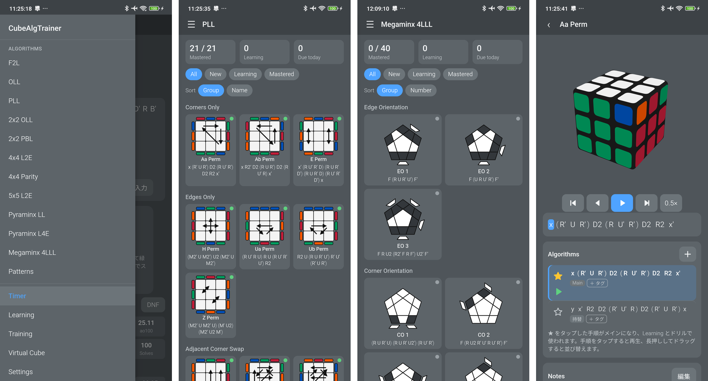
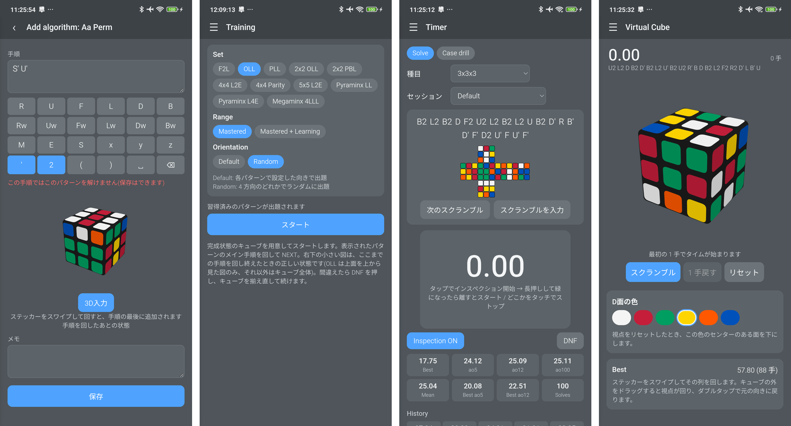

# CubeAlgTrainer

ルービックキューブのアルゴリズムを覚えるための Android アプリです。手順の学習・復習・タイマー・3D キューブ操作がひとつになっています。無料で、通信もアカウントも使いません。

A free Android app for learning speedcubing algorithms: study, spaced-repetition review, a timer and a 3D virtual cube in one place. No network access, no account.




## 主な機能 / Features

- **手順の学習**: F2L、OLL、PLL、2x2 OLL / PBL、4x4 L2E / Parity、5x5 L2E、ピラミンクス LL / L4E、メガミンクス 4LLL。自分のセットも作れます。3D 表示とアニメーションつき。
- **復習**: 間隔反復、クイズ、トレーニング。
- **3D 入力**: キューブのステッカーをスワイプして手順を記録できます。
- **タイマー**: 3x3〜7x7、片手、ピラミンクス、スキューブ、メガミンクス、スクエア1、クロック。スクランブル表示、統計、CSV の読み込み・書き出し。
- **Virtual Cube**: 画面上のキューブを指で回して解くゲーム。
- 日本語・English

## ダウンロード / Download

[**Releases**](../../releases/latest) から APK を入手してください。

インストールには、端末の「提供元不明のアプリ」のインストールを許可する必要があります。Android 8.0 以上が対象です。

Get the APK from [**Releases**](../../releases/latest). You need to allow installing apps from unknown sources. Android 8.0 or later.

## 本物の APK かどうかの確認 / Verifying the APK

このアプリはここの Releases でのみ配布します。ほかの場所で配られている APK は、改ざんや偽物の可能性があります。

正規の APK の署名証明書の SHA-256 は次のとおりです。

```
ab32f7ce7bdf5d0923047772f6a4e4e15e41e5b2d7f5a9fe6b01734cde4046d2
```

確認方法(Android SDK の build-tools が必要):

```
apksigner verify --print-certs CubeAlgTrainer-x.y.z.apk
```

`Signer #1 certificate SHA-256 digest` が上の値と一致しなければ、使わないでください。各 Release には APK 自体の SHA-256 も載せています。

## 利用条件 / Terms

[LICENSE](LICENSE) を参照してください。個人での利用は自由ですが、APK の再配布・転載・改変版の配布は禁止です。

See [LICENSE](LICENSE). Personal use is free; redistributing the APK or distributing modified versions is not allowed.
